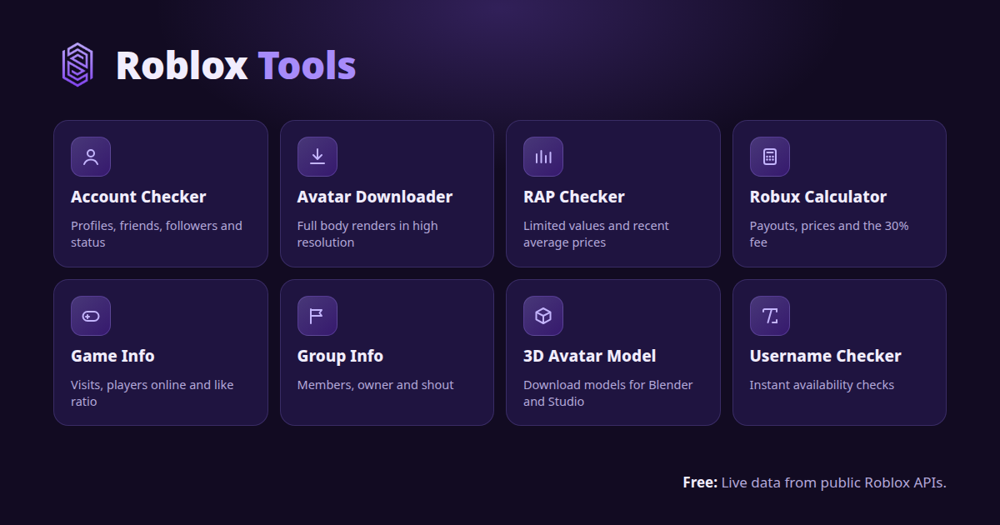
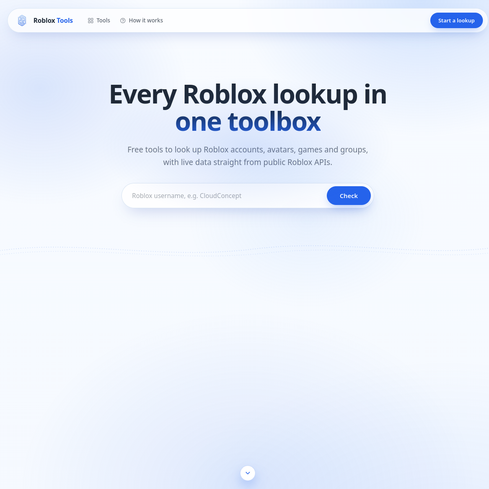
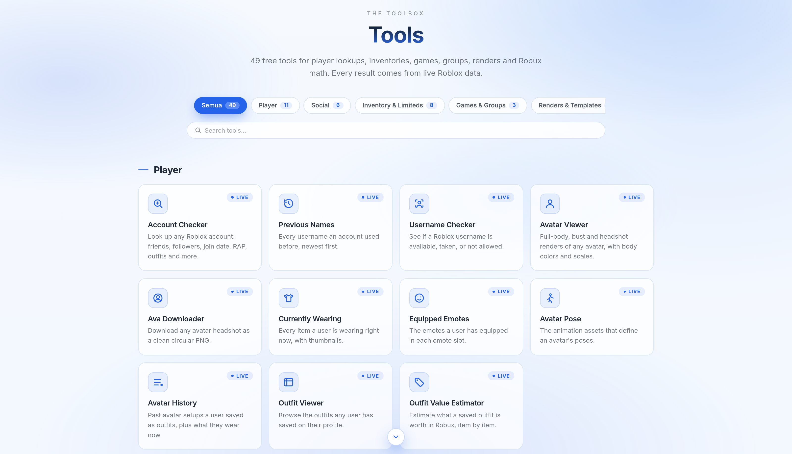

# Roblox Tools

Free tools to look up Roblox accounts, avatars, games, groups and more. Live data from public Roblox APIs. No login, no install.

**Live site: https://roblox.xsrazy.web.id**

## About

Roblox Tools is a free lookup toolbox for Roblox at [roblox.xsrazy.web.id](https://roblox.xsrazy.web.id). It packs 49 tools into one site: account and avatar checks, friend and follower lists, inventory and limited item values, game and group info, avatar renders and 3D models, Robux calculators, and a local account tracker. Every result comes from live Roblox data, and everything runs in the browser without an account.

This repository is a snapshot of the live site (Vercel project `roblox-tools`, production deployment `dpl_9uCN2sceYixPBMs7nFBGpYFbT2zo`). It contains the complete frontend exactly as served by the live deployment: 124 files, 108 of them HTML pages. The 24 server-side API handlers are not included, because their source is not served publicly; on the live site they run as deployed serverless functions. See [Notes](#notes).

Site version: **v1.6.21** (6 November 2026). Full version history: [Changelog](https://roblox.xsrazy.web.id/changelog.html).

## Screenshots

Homepage, with the account checker and live stats:

The toolbox section, with category filters and tool search:

## Features

- **49 free tools in 8 categories**, listed in full in the [tool catalog](#tool-catalog) below.
- **Live data only.** Results come from Roblox public APIs through the site's `/api/*` endpoints, never from a cached database.
- **Shareable result cards.** The account checker builds a profile card (avatar, counts, RAP, join date) that can be downloaded as a framed PNG named after the user.
- **3D avatar models.** View any avatar in 3D and download the model files for Blender or Roblox Studio.
- **Live game servers.** Public servers of a game with player counts, ping and FPS.
- **Calculators with 16 currencies.** Robux conversions use the DevEx rate (USD 3.80 per 1,000 Robux) with live exchange rates and a dated fallback snapshot.
- **Recently Looked Up.** Every lookup on the site is recorded, and the latest 12 appear on the [Recently Looked Up](https://roblox.xsrazy.web.id/recent.html) page, each one click away from a fresh check.
- **Local tracking.** The tracker keeps its list and snapshots in the browser (localStorage), so tracked accounts never leave the device.
- **55 guides and blog posts**, one for every tool plus general explainers.
- **No login, no sign-up, no install, no cost.**

## Tool catalog

### Player (11)

| Tool | What it does |
| --- | --- |
| Account Checker | Look up any Roblox account: friends, followers, join date, RAP, outfits and more. |
| Previous Names | Every username an account used before, newest first. |
| Username Checker | See if a Roblox username is available, taken, or not allowed. |
| Avatar Viewer | Full-body, bust and headshot renders of any avatar, with body colors and scales. |
| Ava Downloader | Download any avatar headshot as a clean circular PNG. |
| Currently Wearing | Every item a user is wearing right now, with thumbnails. |
| Equipped Emotes | The emotes a user has equipped in each emote slot. |
| Avatar Pose | The animation assets that define an avatar's poses. |
| Avatar History | Past avatar setups a user saved as outfits, plus what they wear now. |
| Outfit Viewer | Browse the outfits any user has saved on their profile. |
| Outfit Value Estimator | Estimate what a saved outfit is worth in Robux, item by item. |

### Social (6)

| Tool | What it does |
| --- | --- |
| Friends List | The full friends list of any user, read through a signed-in session. |
| Mutual Friends | Friends two users have in common. |
| Followers List | Browse who follows a user, page by page. |
| Following List | Browse who a user follows, page by page. |
| User Badges | Player badges a user has earned across experiences. |
| Avatar 3D Model | View and download the 3D model files of any avatar. |

### Inventory and Limiteds (8)

| Tool | What it does |
| --- | --- |
| RAP Checker | Total RAP, limited count and the most valuable limiteds of a public inventory. |
| Recent Items | The limited items a user acquired most recently. |
| Cheapest Limited | The lowest-RAP limited items inside a user's inventory. |
| Item Checker | Check whether a user owns a specific item. |
| UAID Lookup | Find the UAID and serial of a user's own copy of a limited item. |
| Initial Necklaces | Check if a user owns any of the initial necklace items. |
| Pacifiers | Check if a user owns any of the pacifier items. |
| Group Item Scan | Scan a user's inventory for items created by a specific group. |

### Games and Groups (3)

| Tool | What it does |
| --- | --- |
| Game Info | Playing counts, visits, votes and details for any Roblox game. |
| Game Servers | Live public servers of a game: players, ping and FPS. |
| Group Check | A user's groups, roles and ranks, plus group details. |

### Renders and Templates (8)

| Tool | What it does |
| --- | --- |
| Shirt & Pants Template | Get the flat template texture of a classic shirt or pants asset. |
| Avatar Render | High-resolution 2D renders: full body, bust and headshot. |
| Outfit Render | Render a saved outfit as a downloadable item sheet. |
| Outfits Gallery | All of a user's outfits as item sheets, each downloadable as PNG. |
| Asset Render | The largest available render of any catalog asset. |
| Bundle Render | Render and details for any avatar bundle. |
| 2D Avatar Render | Custom 2D avatar renders with size and framing options. Experimental. |
| CAC Avatar Render | Render a CAC outfit by its outfit ID as an item sheet. |

### Calculators (3)

| Tool | What it does |
| --- | --- |
| Robux to USD | Convert Robux to USD, IDR, EUR and 13 more currencies at the DevEx rate or your own rate. |
| USD to Robux | Convert USD, IDR, EUR and 13 more currencies back to Robux at a labeled rate. |
| Robux Tax Calculator | What you keep after the 30% marketplace fee, and what to charge to net a target amount. |

### History and Compare (3)

| Tool | What it does |
| --- | --- |
| User History | Join date, account age, name changes and current counts in one report. |
| Compare Users | Two accounts side by side: counts, RAP, join dates and more. |
| Stat Graph | A bar chart of a user's public counts, with optional head-to-head. |

### Tracking (7, on one page)

The User Tracker page hosts seven functions that work on a list stored in the browser: Add User, Your List, Check Now, Count, Settings, Remove User and Remove All. Snapshots make it easy to spot follower and RAP changes between checks.

## Pages

Next to the tools, the site ships a full set of info pages:

- **Features, FAQ, Guides, Blogs**: highlights, answers grouped by topic with a live search filter, 12 tutorial cards, and the blog index with 55 posts.
- **About**: how the site started (one checker that grew into 49 tools in a day) and what it runs on.
- **Contact**: the contact email and the three kinds of reports the site accepts.
- **Status**: live status of the site, the Roblox APIs, the lookup history and the tracking storage.
- **Changelog**: every release since launch, currently 40 releases and 76 changes.
- **Recently Looked Up**: the latest 12 lookups across the whole site.
- **Terms and Privacy**: the rules and the data policy, each section in its own card with a side navigation.

## Architecture

- **Frontend:** static HTML, CSS and JavaScript under `src/`, no framework. Shared code lives in `src/assets/tools.css` and `src/assets/tools.js`. Vendor libraries: three.js r128 (3D rendering) and html-to-image (PNG export of the result card).
- **Typography:** one self-hosted font family, Inter (`src/fonts/`), used on every page including the exported result card.
- **Design:** light blue glass theme. Primary blue `#2563EB`, glass cards `rgba(255,255,255,.72)` with a `#D9E6F5` border and 16px radius, page background built from soft blue radial glows over `#F8FBFF` to `#E9F1FD`. The OG image (`src/og.png`) uses the same values, the same logo file and the same tool names and descriptions as the homepage.
- **Backend (not in this repo):** 24 serverless API handlers that proxy Roblox public APIs and power every tool. See the [API](#api) table.
- **Lookup history:** a Cloudflare D1 database behind `/api/history`. New lookups are validated and deduplicated, and the endpoint returns the latest 12.
- **Session tools:** six tools (Friends List, Mutual Friends, Followers List, Following List, User Badges, Avatar 3D Model) need data that Roblox only serves to signed-in accounts. On the live site they run through a session stored as a server-side environment variable, never in code. If that session is unavailable, those six tools say so and the other 43 keep working.
- **Hosting:** Vercel (project `roblox-tools`). The domain `roblox.xsrazy.web.id` points to Vercel through a Cloudflare DNS CNAME.
- **Stateless frontend.** The pages are static; all live data comes through the `/api/*` endpoints, and the only state kept anywhere is the lookup history (D1) and the tracker list (browser localStorage).

## API

Base URL: `/api/<name>`. These endpoints run as deployed serverless functions on the live site; they are documented here from the deployment's handler list and the tool pages that call them. They are not part of this repo.

| Endpoint | Purpose |
| --- | --- |
| `/api/user` | Look up a user by username or ID. |
| `/api/username-history` | Previous usernames of a user. |
| `/api/validate-username` | Check whether a username is available, taken or not allowed. |
| `/api/avatar-info` | Avatar data and equipped assets. |
| `/api/avatar-render` | 2D avatar renders. |
| `/api/avatar-3d` | 3D avatar model data (session-backed). |
| `/api/outfits` | Saved outfits of a user. |
| `/api/outfit-details` | Items of a saved outfit. |
| `/api/outfit-value` | Robux value of a saved outfit, item by item. |
| `/api/badges` | Badges earned by a user (session-backed). |
| `/api/history` | Latest 12 lookups site-wide, and recording new lookups. |
| `/api/game` | Game info from a Universe or Place ID. |
| `/api/servers` | Live public servers of a game. |
| `/api/groups` | A user's groups, plus group details. |
| `/api/group-scan` | Scan an inventory for items created by a group. |
| `/api/inventory` | A user's public inventory and RAP data. |
| `/api/inventory-scan` | Scan a user's inventory for specific items. |
| `/api/asset-info` | Details of a catalog asset. |
| `/api/bundle-info` | Details of a bundle. |
| `/api/catalog-candidates` | Catalog search candidates for value lookups. |
| `/api/thumbs` | Thumbnail URLs, proxied so pages can use them cross-origin. |
| `/api/resolve` | Resolve usernames, user IDs and profile or group links. |
| `/api/social` | Friends, followers, following and mutuals (session-backed). |
| `/api/probe` | Liveness probe for the backend. |

## Changelog

The site launched on 5 November 2026 and is versioned on every deploy. A deploy script logs each release with its date and time (WIB) and rebuilds the public changelog page. Current state: **40 releases, 76 changes, latest v1.6.21**.

Recent releases:

| Version | Date | Summary |
| --- | --- | --- |
| v1.6.21 | 6 November 2026, 03:53 WIB | OG image aligned to the site, value by value |
| v1.6.20 | 6 November 2026, 03:48 WIB | OG image speaks the site language now |
| v1.6.19 | 6 November 2026, 03:47 WIB | OG image refreshed in Inter |
| v1.6.18 | 6 November 2026, 03:41 WIB | New blue OG image |
| v1.6.17 | 5 November 2026, 23:33 WIB | Every page header now matches the homepage |
| v1.6.16 | 5 November 2026, 23:30 WIB | Change count gets a soft chip |

Full history: https://roblox.xsrazy.web.id/changelog.html

## Not included, on purpose

Two checks were researched and left out because no honest data source exists for them:

- **Price Floor.** Roblox retired the resellers endpoint a price floor would need (it answers HTTP 410), and no other public floor source exists.
- **Rotection-style safety scores.** The rotector API is unreachable from the site's hosting, so those checks cannot be served reliably.

Favorite Games and Last Online are also not offered: the endpoints behind them no longer return that data.

## Notes

- **Snapshot scope.** This repo holds the 124 frontend files of the production deployment `dpl_9uCN2sceYixPBMs7nFBGpYFbT2zo`. The 24 server-side API handlers and their compiled bundles are not included because their source is not served publicly. The `/api/*` endpoints on the live site run as deployed serverless functions, so the tools that call them need the live backend (or an equivalent one) to work from this repo alone.
- **Deploys do not come from this repo.** The live site is deployed from a separate working copy with a deploy script that logs the changelog on every release. This repo mirrors the result after each meaningful update.
- **Game servers and 3D models work on the live site.** The same Roblox endpoints reject requests from some datacenter IPs, which is why those tools depend on this backend.

## Credits

- **Created and maintained by Rahmatul Usra** ([@xsrazy](https://github.com/xsrazy)): design, development, content and upkeep of Roblox Tools and of this snapshot. Live site: https://roblox.xsrazy.web.id
- **Data: Roblox.** Every lookup result comes from the public Roblox APIs (users, avatar, thumbnails, inventory, collectibles, games, groups, catalog and presence). Game names, item names, images and all other game data belong to Roblox Corporation and the respective creators. Roblox is a registered trademark of Roblox Corporation. This project is not affiliated with, endorsed by, or sponsored by Roblox Corporation.
- **Open source libraries:**
  - **three.js r128** (MIT License, Three.js contributors): 3D avatar and outfit rendering.
  - **html-to-image** (MIT License): PNG export of the account result card.
- **Typography:** Inter, designed by Rasmus Andersson and released under the SIL Open Font License 1.1. Self-hosted, no external font requests.
- **Icons:** inline SVG icons on a 24x24 stroke grid, embedded directly in the pages. No icon font, no external requests.
- **Exchange rates:** live rates from open.er-api.com (ExchangeRate-API) in the Robux calculators, with a dated fallback snapshot stored in the page when the service is unreachable.
- **Infrastructure:** Vercel (hosting and serverless functions) and Cloudflare (DNS, plus the D1 database behind the lookup history).
- **Screenshots:** captured from the live site on 6 November 2026.

The Roblox Tools source code in this repo is MIT licensed (see [LICENSE](LICENSE)). Third-party components keep their own licenses, as listed above.

## License

MIT. See [LICENSE](LICENSE).
