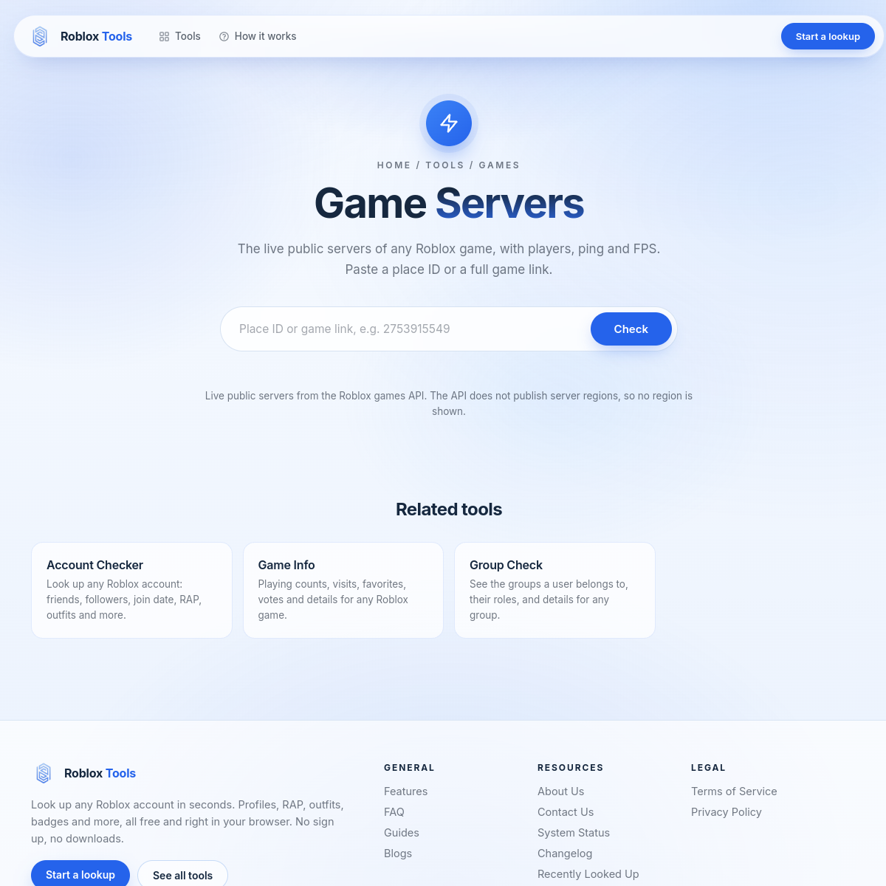

# Roblox Tools

Free tools to look up Roblox accounts, avatars, games, groups and more. Live data from public Roblox APIs. No login, no install.

Live: https://roblox.xsrazy.web.id

## About

A snapshot of the Roblox Tools site deployed at roblox.xsrazy.web.id (Vercel project `roblox-tools`). The site offers free Roblox lookup tools in English: account and avatar checks, game and group info, inventory and limited-item prices, CAC renders, 3D avatar models, tracking, and Robux calculators, plus guides and a blog. Everything runs without an account.

This repo contains the frontend exactly as served by the live deployment (122 files). The 24 server-side API handlers are not included: their source is not served publicly, and the live site's `/api/*` endpoints run as deployed serverless functions. See [Notes](#notes).

## Features

- **42 dedicated tool pages** plus the homepage account checker (the homepage lists 49 free tools).
- **55 blog and guide pages** explaining the tools and Roblox concepts.
- **Live data.** Results come from Roblox public APIs through the site's `/api/*` endpoints.
- **3D avatar models.** Render and download avatar and outfit models for Blender and Studio.
- **Game servers.** Live public servers with players, ping, and FPS.
- **No login, no sign-up, no install.**

## Screenshots

Homepage:

Game Servers tool:

## Architecture

- **Frontend:** static HTML, CSS, and JavaScript under `src/` (no framework). Shared assets: `src/assets/tools.css` and `src/assets/tools.js`. Vendor libraries: three.js r128 (3D rendering) and html-to-image (PNG export). Fonts are self-hosted (Inter, JetBrainsMono, Sora).
- **Backend (not in this repo):** 24 serverless API handlers (`src/api/*.js` in the deployment), compiled to `out/api/*` functions. They proxy Roblox public APIs and power every tool. See the [API](#api) table.
- **Hosting:** Vercel (project `roblox-tools`), custom domain `roblox.xsrazy.web.id`.
- **Stateless frontend.** The pages are static; all live data comes through the `/api/*` endpoints.

## API

Base URL: `/api/<name>`. These endpoints run as deployed serverless functions on the live site; they are documented here from the deployment's file list and the tool pages that call them. They are not part of this repo.

| Endpoint | Purpose |
| --- | --- |
| `/api/user` | Look up a user by username. |
| `/api/username-history` | Previous usernames of a user. |
| `/api/validate-username` | Check whether a username is available. |
| `/api/avatar-info` | Avatar data and equipped assets. |
| `/api/avatar-render` | 2D avatar renders. |
| `/api/avatar-3d` | 3D avatar model data. |
| `/api/outfits` | Saved outfits of a user. |
| `/api/outfit-details` | Items of a saved outfit. |
| `/api/outfit-value` | Robux value of a saved outfit. |
| `/api/badges` | Badges of a user. |
| `/api/history` | Badge and username history. |
| `/api/game` | Game info from a Universe or Place ID. |
| `/api/servers` | Live public servers of a game. |
| `/api/groups` | Group info and a user's groups. |
| `/api/group-scan` | Items created by a group. |
| `/api/inventory` | A user's inventory. |
| `/api/inventory-scan` | Scan a user's inventory for specific items. |
| `/api/asset-info` | Details of a catalog asset. |
| `/api/bundle-info` | Details of a bundle. |
| `/api/catalog-candidates` | Catalog search candidates. |
| `/api/thumbs` | Thumbnail URLs. |
| `/api/resolve` | Resolve usernames, IDs, and links. |
| `/api/social` | Friends, followers, and mutuals. |
| `/api/probe` | Liveness probe. |

## Notes

- **Snapshot scope.** This repo holds the 122 frontend files served by the live deployment (deployment `dpl_BnZ969FQ7GbxMcxwgPEwCu6bWJdQ`). The 24 server-side API handlers (`src/api/*.js`) and their compiled bundles (`out/api/*`) are not included because their source is not served publicly. The `/api/*` endpoints on the live site run as deployed serverless functions, so the tools that call them need a backend to work from this repo alone.
- **Game servers and 3D models work here.** The live backend returns game servers and 3D avatar/outfit models. The same endpoints reject requests from some datacenter IPs (verified against a separate Vercel backend), so those tools depend on this backend.
- **Design.** The live site uses a light blue/white theme. The OG image (`src/og.png`) uses an older dark-purple design with 8 tool cards.

## Credits

Snapshot of the Roblox Tools site at https://roblox.xsrazy.web.id (Vercel project `roblox-tools`).

## License

MIT. See [LICENSE](LICENSE).
